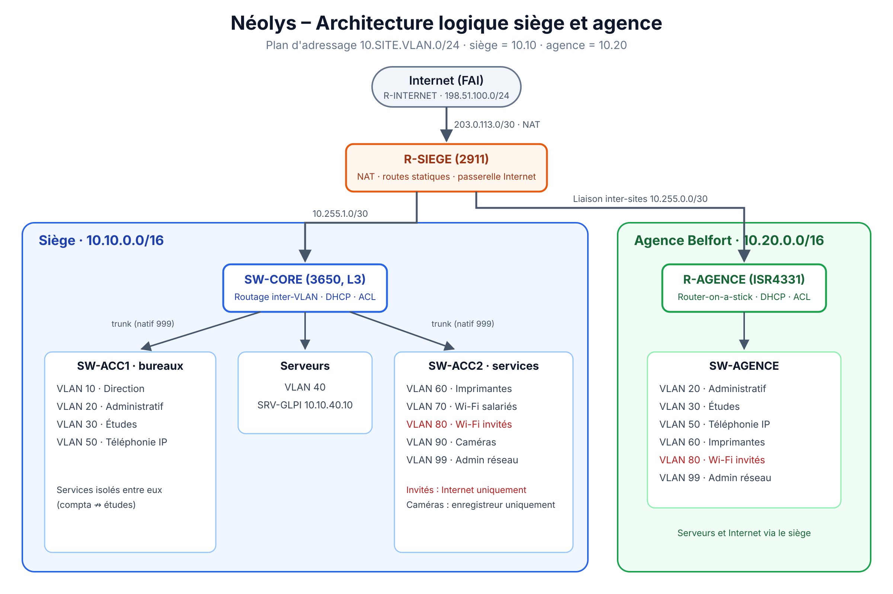
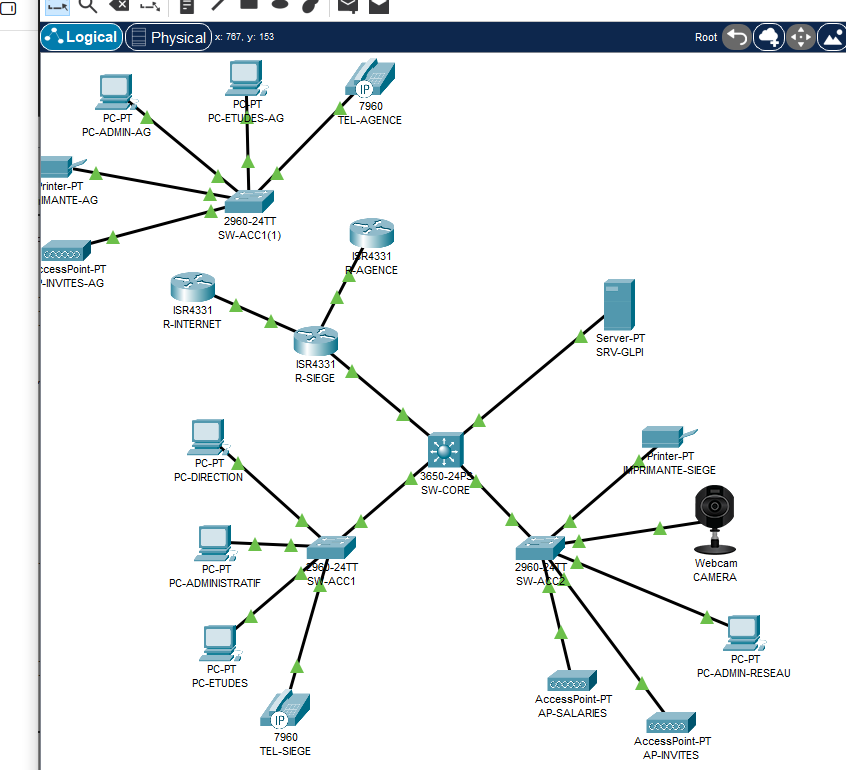
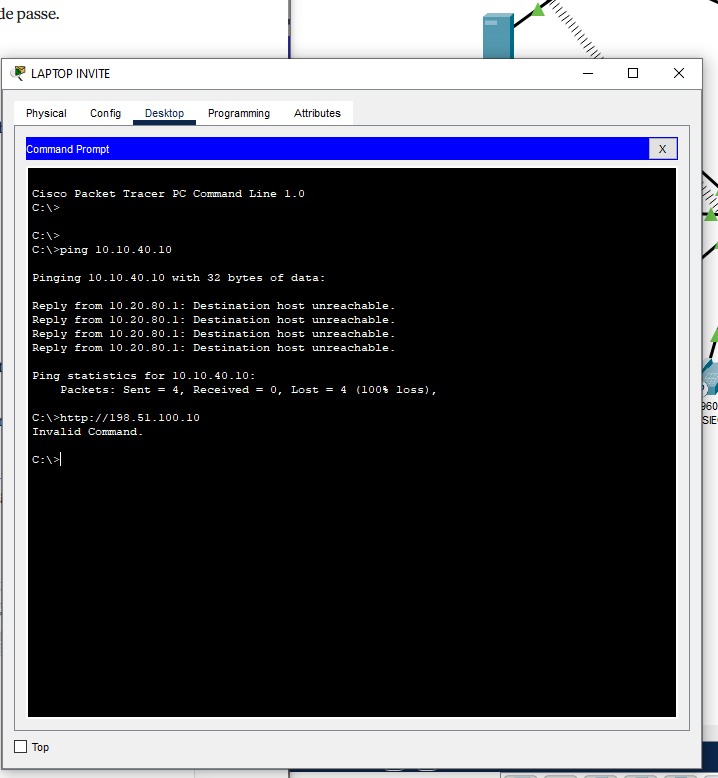
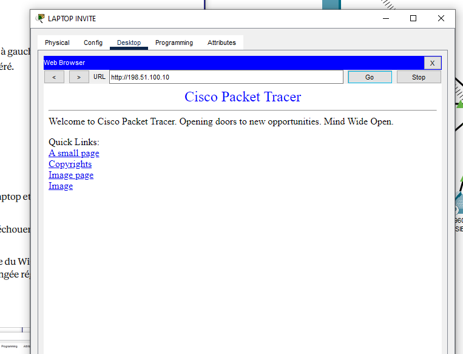
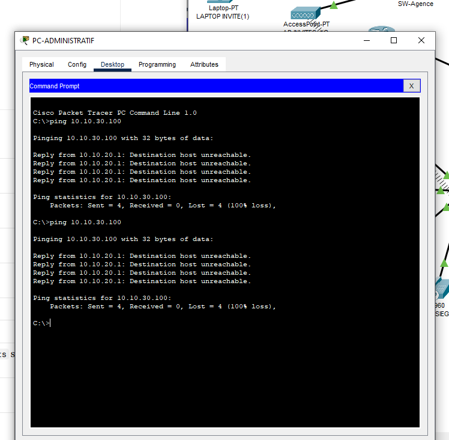
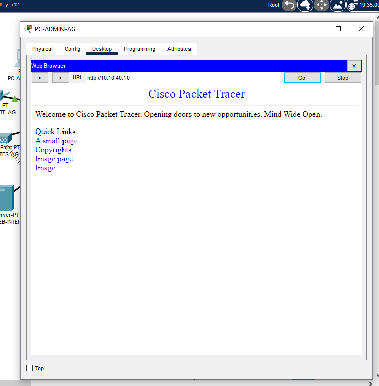
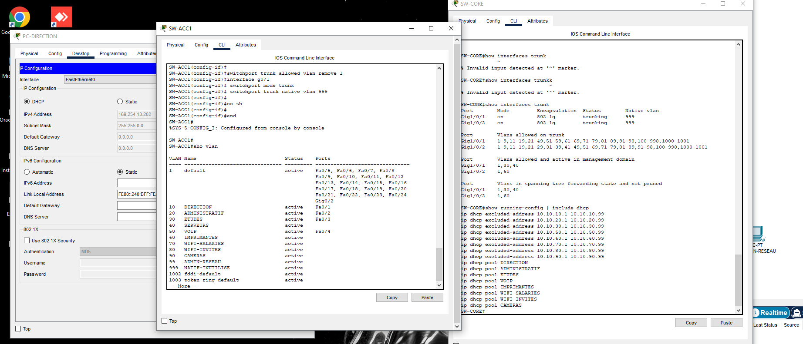

# Lab Néolys – Projet 3 : concevoir le réseau du siège et de l'agence

Projet 3 de mon parcours autodidacte **Administrateur systèmes, réseaux et cybersécurité**.

## Contexte

Néolys (PME fictive de 45 salariés) déménage son siège et ouvre une agence à Belfort. Le réseau actuel est « à plat » : postes, serveurs, imprimantes, caméras et Wi-Fi des invités sont tous dans le même réseau. Un visiteur connecté au Wi-Fi peut voir le serveur de fichiers, et un poste infecté peut atteindre toute l'entreprise.

**Mission** : concevoir une architecture segmentée, sécurisée et évolutive pour les deux sites, la maquetter, prouver chaque règle de sécurité, puis planifier le déploiement et le présenter à la direction.

## Résultat

| Élément | Réalisé |
|---|---|
| Segmentation | 11 VLAN par usage (direction, administratif, études, serveurs, VoIP, imprimantes, Wi-Fi salariés, Wi-Fi invités, caméras, administration, natif inutilisé) |
| Plan d'adressage | `10.SITE.VLAN.0/24` : lisible et évolutif (un nouveau site = 10.30.x.x) |
| Siège | Switch de niveau 3 (routage inter-VLAN, DHCP, ACL), 2 switchs d'accès, routeur avec NAT |
| Agence | Routeur en router-on-a-stick (sous-interfaces 802.1Q), DHCP local, ACL |
| Liaison entre sites | Liaison routée /30, routes statiques |
| Sécurité | Matrice de flux appliquée par ACL étendues, VLAN natif dédié, invités isolés, caméras sans accès à Internet |
| Preuves | 6 tests de la matrice, captures à l'appui |
| Maquette | [Fichier Packet Tracer](packet-tracer/neolys-reseau-2-sites.pkt) |

## Documentation

- [Plan d'adressage, VLAN et ports](docs/plan-adressage.md)
- [Matrice de flux, ACL et preuves](docs/matrice-flux.md)
- [Plan de déploiement avec retour arrière](docs/plan-deploiement.md)
- [Journal de dépannage](docs/journal-depannage.md)
- Présentation à la direction (9 diapositives, sans jargon) : à exporter en PDF depuis Claude et à déposer dans `docs/presentation-direction.pdf`

## La maquette

## Les preuves de la matrice de flux

| Règle | Test | Résultat |
|---|---|---|
| Invités → réseau interne | Ping vers le serveur | ❌ Bloqué |
| Invités → Internet | Page web | ✅ |
| Administratif → Études | Ping | ❌ Bloqué (isolation entre services) |
| Direction → Internet | Ping | ✅ (NAT) |
| Études → imprimante | Ping | ✅ |
| Agence → serveur du siège | Page web de GLPI | ✅ |

**Invité bloqué vers le serveur interne, mais Internet fonctionne**

**Isolation entre services : la compta ne voit pas le bureau d'études**

**L'agence accède au serveur du siège à travers la liaison entre les sites**

## Dépannage

Le diagnostic le plus instructif : un PC sans adresse DHCP alors que tout semblait « up ». La cause était des VLAN retirés des trunks, visible uniquement avec `show interfaces trunk`.

Détails dans le [journal de dépannage](docs/journal-depannage.md).

## Compétences mises en œuvre

VLAN et trunks 802.1Q · Routage inter-VLAN (SVI et router-on-a-stick) · DHCP · NAT/PAT · Routage statique · ACL étendues · Conception d'un plan d'adressage · Matrice de flux · Plan de déploiement et de retour arrière · Présentation à des non-techniciens · Cisco IOS, Packet Tracer

## Prochaine étape

Projet 4 : déployer des services web Linux sécurisés.
